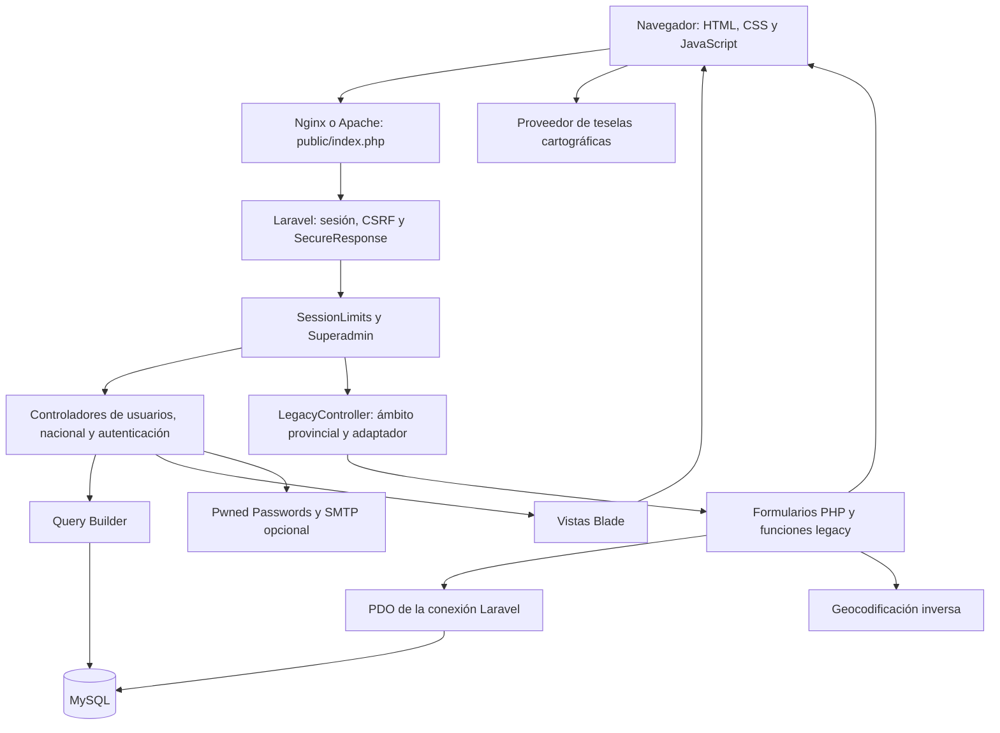
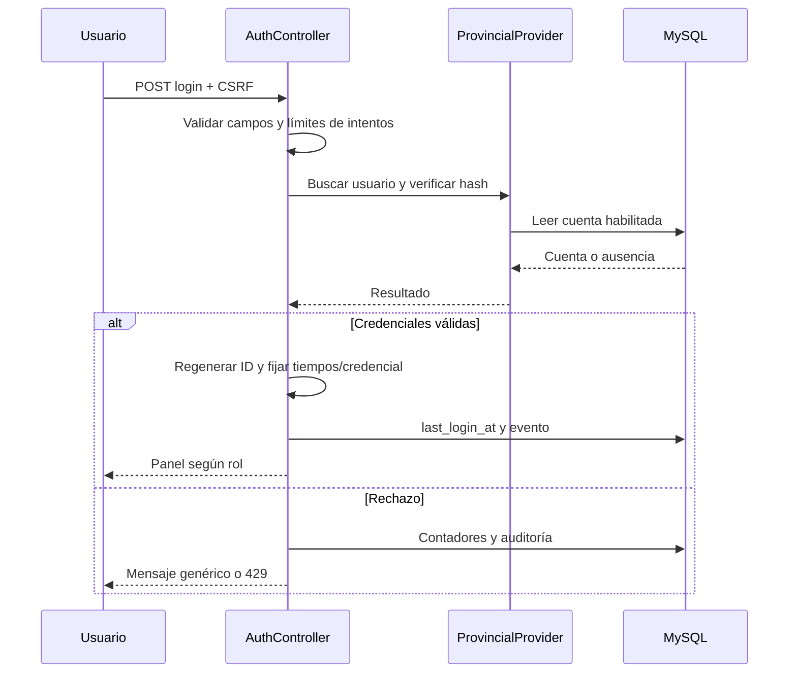
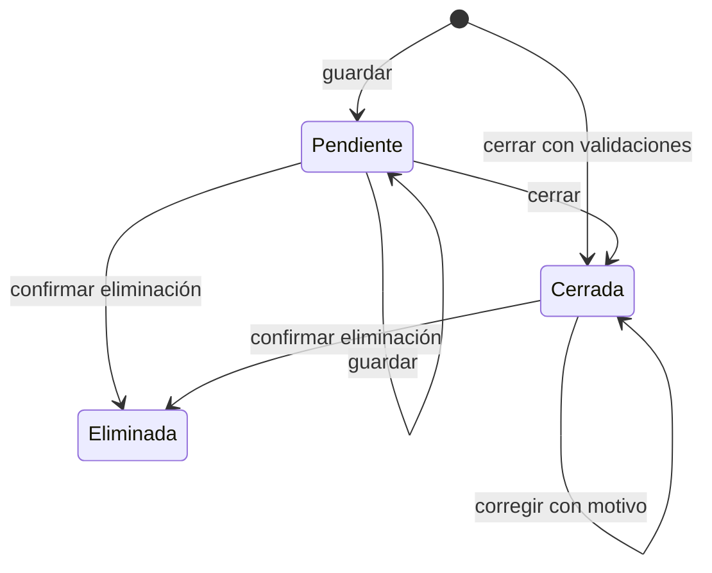

# Arquitectura del sistema APH

Versión documental: 1.1 · 25 de noviembre de 2026. Implementación de referencia: commit 6fa336e y posteriores. Audiencia: desarrollo, mantenimiento y revisión técnica. Este documento describe el código actual, no una arquitectura futura.

## Propósito y límites

El sistema sustituye la circulación de matrices provinciales Excel por un registro central de atenciones prehospitalarias. Permite captura incompleta controlada, cierre, corrección, historial, recursos, supervisión nacional y análisis. Conserva las 30 columnas institucionales en un JSON por ficha. No es historia clínica longitudinal, sistema de despacho en tiempo real, repositorio nacional de pacientes ni servicio de emergencias con disponibilidad certificada.

## Componentes

Laravel administra rutas, sesión y configuración. `LegacyController` decide el ámbito, traduce Request a estructuras del formulario original y encapsula cuerpo, cabeceras y redirecciones mediante LegacyTransport/LegacyStop. No abre una segunda sesión PHP ni expone legacy/ como raíz web. PDO se obtiene mediante `DB::connection()->getPdo()`, por lo que Laravel y los formularios usan la misma base.

Los modelos de dominio no están implementados con Eloquent. No existen capas Repository/DTO/FormRequest generales: la validación vive en controladores, InstitutionalEmail, PasswordPolicy y legacy/modelo.php. La autorización combina middleware, ámbito provincial y condiciones SQL. No hay Policies/Gates de dominio que deban describirse como implementados.

## Organización del código

| Directorio/archivo | Responsabilidad |
| --- | --- |
| app/Auth/ProvincialProvider.php | Lectura de accounts y validación de credenciales; devuelve GenericUser. |
| app/Http/Controllers/AuthController.php | Login/logout, estado y renovación de sesión, revocación. |
| app/Http/Controllers/UsersController.php | Alta, filtros, edición, suspensión y activación administrativa. |
| app/Http/Controllers/NationalController.php | Listado nacional y selección de ámbito para operar. |
| app/Http/Controllers/LegacyController.php | Aislamiento provincial, adaptación de formularios, auditoría de accesos. |
| app/Services/AccountInvitations.php | Ticket y código de activación, envío síncrono de correo. |
| app/Security/ | Política de claves y eventos/revocación. |
| legacy/modelo.php | Validación, transacción de ficha, control de versión y borrado lógico. |
| legacy/cuentas.php | Perfil e imagen, cambio de contraseña e identidad operativa. |
| legacy/dashboard-vista.php | Selección autorizada de datos estadísticos para navegador. |
| public/dashboard-mapas.js | Agregación, gráficos, mapas y filtros cruzados. |
| legacy/exportar.php | XLSX mediante ZipArchive y GeoJSON. |
| legacy/impresion-vista.php | Hoja HTML imprimible; PDF mediante navegador. |
| database/migrations/ | Esquema y evolución de cuentas. |

`legacy/dashboard-analitica.php` conserva una implementación anterior; la vista interactiva vigente usa dashboard-vista.php y dashboard-mapas.js. No confundir código conservado con gráficos activos.

## Autenticación y autorización

El guard `web` utiliza sesión y el provider `provincial`. Fuente: accounts. Se admite login solo con active y (`legacy_access` o email_verified_at). Los usuarios migrados tienen excepción temporal sin verificación. La cuenta nacional tiene role=superadmin y province=NULL; un técnico tiene role=technician y clave provincial. El dominio de correo se compara con la lista exacta autorizada, pero actualmente no se exige que su subdominio coincida con la provincia asignada.

La tabla auth_security y la dependencia google2fa son remanentes; no hay rutas MFA activas. Tampoco hay Sanctum, Breeze o Jetstream. La configuración estándar del broker de recuperación no constituye un flujo operativo de “olvidé mi contraseña”. La recuperación administrativa se describe en el manual.

## Flujo de atención

1. El servidor obtiene provincia de la cuenta; el superadministrador selecciona provincia o deriva la de la ficha que abre.
2. Carga recursos y catálogos de ese ámbito. En fichas nuevas el responsable se asigna desde la cuenta, no desde un campo libre. En correcciones se conserva el responsable previo; el editor actual aparece en el historial.
3. `guardar` conserva Pendiente; `cerrar` valida campos de cierre; una ficha Cerrada se corrige con `corregir` y motivo. No hay flujo de reapertura implementado.
4. Se valida recurso provincial, datos y coordenadas. Se preservan excepciones explícitas para valores históricos.
5. En una transacción se inserta o actualiza la ficha, se escribe cambios y se registra el evento de auditoría; si algo falla, no se guarda nada. UPDATE incluye id, provincia, version y eliminado IS NULL. Las claves del JSON fuera de A–AD se conservan y sus cambios quedan en el historial.
   - El motivo por defecto describe la acción: creación, actualización de pendiente o cierre.
   - Cada formulario nuevo lleva un identificador `solicitud` único: un doble envío devuelve la ficha ya creada y, si los datos difieren, se avisa sin descartarlos.
   - Los errores de validación se devuelven por campo: resumen enlazado y enfocable, mensaje junto al control y `aria-invalid`.
6. Si la versión cambió, se rechaza el guardado para evitar sobrescribir otra edición; el usuario debe recargar y conciliar.
7. Eliminar modifica eliminado, incrementa version y deja auditoría; no borra filas ni aplica cascadas.

Eliminada es visibilidad lógica, no un tercer valor de la columna estado. No hay botón de restauración; una restitución requiere procedimiento autorizado y auditado.

## Edición administrativa

El modal envía PUT a users.update con CSRF y edit_user_id. Los errores regresan a users.index y solo se muestran en el modal correspondiente. Contraseña vacía conserva el hash. Correo único ignora la propia cuenta. La edición de rol/provincia sincroniza o crea operador sin mover fichas históricas; invalida invitaciones y sesiones previas. La edición propia conserva sesión solo si la cuenta sigue siendo válida. Cambiar correo en una cuenta sin excepción temporal exige nueva activación.

## Métricas, mapas y salidas

El dashboard carga fichas no eliminadas del ámbito y del periodo elegido (por defecto los últimos 12 meses, hasta 10.000 atenciones; avisa si hay más). MySQL entrega solo los campos del panel, mediante la columna generada `fecha` y sus índices. Incluye Pendientes y Cerradas; no es transmisión en tiempo real: se actualiza con la carga de página y los filtros locales. JSON estadístico excluye nombre, documento y diagnóstico libre, pero conserva hoja y coordenadas: sigue siendo información de acceso restringido.

| Indicador | Definición |
| --- | --- |
| Atenciones y estados | Número de fichas visibles tras filtros; no pacientes únicos. |
| Despachos | Fichas con J no vacío; no número de viajes deduplicados. |
| Tipo de recurso | Recurso_tipo histórico, o tipo actual enlazado si falta copia. |
| Kilómetros | Suma AA − Z con valores finitos, no negativos y llegada ≥ salida, agrupada por B. |
| Pirámide | 0–4, 5–14, 15–24, 25–34, 35–44, 45–54, 55–64, 65+; edad no válida separada. |
| Provincias | Conteos de fichas, color relativo al máximo; no tasa por población. |

Los filtros se combinan; seleccionar otra vez una categoría la desactiva. Puntos filtran por ID de ficha. Las provincias conservan orden alfabético. No se muestran gráficos de CIE-10 ni por unidad individual en el panel actual. Con 30.000 fichas ficticias, el panel nacional respondió en 0,8 s; el listado provincial se pagina de 30 en 30. El Excel todavía se construye completo en memoria.

Leaflet consume teselas externas. PHP consulta Nominatim con coordenadas redondeadas a cuatro decimales, caché y limitación global de consulta; la ficha guarda hasta seis decimales. Las direcciones son referencias aproximadas. La política Permissions-Policy deshabilita geolocalización del dispositivo: el usuario selecciona el punto manualmente. Las coordenadas consultadas salen al proveedor, aunque no se envíen nombres de pacientes.

XLSX y GeoJSON incluyen solo cerradas no eliminadas del ámbito. GeoJSON evita nombres/documentos, pero sus puntos también pueden ser sensibles. PDF es impresión HTML del navegador; no existe un generador PDF del servidor. Los mapas impresos dependen de carga de teselas y conexión externa.

## Dependencias y decisiones

PHP 8.4 en el piloto, Laravel 13.40 según lock, MySQL 8.4.13 local. Composer lock fija versiones; comprobar requisitos efectivos con `composer check-platform-reqs`. Frontend principal: CSS/JS estáticos, Leaflet y SVG generados por código; no framework SPA ni Chart.js. Vite/Tailwind están en la plantilla de herramientas, no gobiernan las vistas principales actuales.

Decisiones: integración gradual para conservar estructura institucional; JSON para compatibilidad con Excel; hash de contraseña y sesión central; autorización provincial en servidor; eliminación lógica y concurrencia optimista; sin MFA por decisión del piloto. Compromisos: no esquema clínico normalizado, reglas de provincia parcialmente fuera de FK, servicios cartográficos externos, dependencia del verificador de contraseñas y deuda de componentes heredados.

No hay Jobs, Events o Listeners propios ni tareas programadas de negocio. El correo se envía en la petición. Infraestructura de colas disponible no equivale a operación asíncrona activa. Véanse [rutas](rutas-y-permisos.md), [seguridad](seguridad.md), [esquema](base-de-datos/esquema.md) y [operaciones](operaciones.md).
