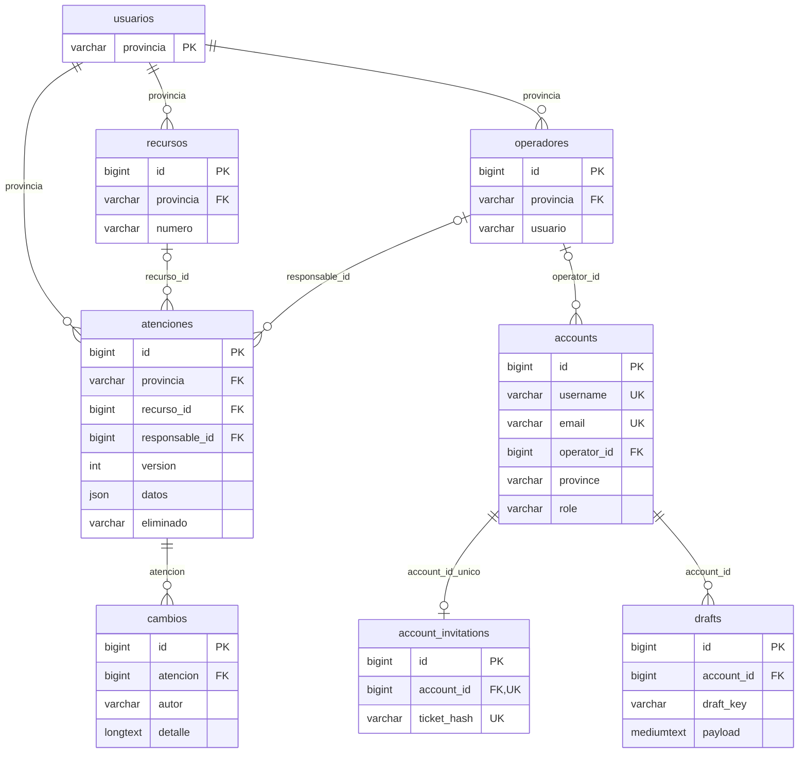

# Relaciones y diagrama entidad-relación

El diagrama muestra únicamente FK físicas. Las tablas auxiliares sin FK se describen en el diccionario. Cada atención pertenece a una provincia; recurso y responsable son opcionales. Una cuenta puede apuntar a un operador, pero operator_id no es UNIQUE: el esquema permite varias cuentas por operador aunque no sea el flujo esperado.

## Relaciones lógicas, no impuestas por MySQL

| Origen | Destino lógico | Garantía y límite |
| --- | --- | --- |
| accounts.province | usuarios.provincia / provincias.json | Validación en controlador; no FK. Nacional usa NULL. |
| perfiles.(provincia, usuario) | Provincia y usuario de la cuenta | PK compuesta; sin FK. Nacional usa provincia `nacional`. |
| sessions.user_id | accounts.id | VARCHAR con índice; no FK. Revocación explícita en código. |
| security_events.identity / target | Identidad u objeto auditado | Texto sin FK; permanece como evidencia histórica. |
| cambios.autor / datos.Y | Nombre/usuario responsable | Copia textual, no FK. No usar para autorización. |
| atenciones.datos.J | recursos.numero | Copia textual; recurso_id mantiene el vínculo cuando existe. |
| atenciones.datos.C/U/F/G | Catálogos APH/CIE/eventos/cantones | Validación en PHP y archivos; no tablas catálogo SQL. |

Las FK individuales no garantizan que recurso y responsable pertenezcan a la misma provincia de una ficha. La aplicación aplica ese aislamiento. Tampoco hay CHECK de role/estado ni unicidad de número de hoja (`datos.K`). Dos fichas pueden compartir número de hoja; el ID interno sigue siendo distinto. No hay tabla de pacientes: una persona puede aparecer en varias fichas sin un identificador maestro.

## Mapeo Laravel–MySQL

No hay relaciones Eloquent hasMany/belongsTo/belongsToMany implementadas para estas tablas. `App\Models\User` es un remanente de plantilla; el proveedor `App\Auth\ProvincialProvider` devuelve `GenericUser` leyendo accounts con Query Builder. Controladores y servicios usan DB; `legacy/modelo.php` usa PDO obtenido de esa misma conexión Laravel. Las vistas Blade y PHP adaptadas consumen arrays u objetos de consulta. No ejecutar el DatabaseSeeder genérico: intenta crear un User de plantilla, no una cuenta institucional.

Las tablas sessions/cache/cache_locks/jobs/job_batches/failed_jobs son infraestructura Laravel; auth_security es herencia del MFA retirado. Su existencia no indica que el sistema utilice MFA ni procesamiento asíncrono actualmente.

## Diagrama exportable

[PNG para informes](diagramas/erd.png) · [SVG vectorial](diagramas/erd.svg) · [Fuente Mermaid](diagramas/erd.mmd). Los archivos exportados corresponden al diagrama anterior, validado mediante renderizado; los campos completos están en el diccionario.
